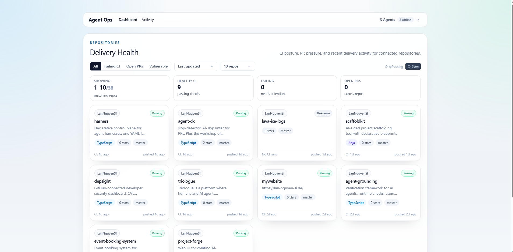

# Agent Ops Dashboard

Operational dashboard for AI agents: live agent registry, shared state store, activity feed, and GitHub repo health.

agent-ops-dashboard is a Next.js + Fastify monorepo that gives AI agents (Claude Code, Codex, custom runners) a place to register, heartbeat, share namespaced state with atomic compare-and-swap, and stream a live activity feed over SSE. The same dashboard also surfaces GitHub repo health (CI status, open PRs, Dependabot vulnerabilities) for every repo under an owner, so a fleet of agents and the humans watching them share one operational view.



## Packages

| Package | Purpose | Docs |
|---|---|---|
| [apps/dashboard](apps/dashboard) | Next.js frontend: agent bar, GitHub repo health, activity feed; pipeline and alert APIs | this README, [docs/architecture.md](docs/architecture.md) |
| [packages/gateway](packages/gateway) | Fastify REST API + SSE: agent registry, shared state store, activity feed | [docs/api.md](docs/api.md), [docs/architecture.md](docs/architecture.md) |
| [packages/client](packages/client) | `@opentriologue/client`: CLI + SDK for the gateway | [packages/client/README.md](packages/client/README.md) |
| [packages/mcp](packages/mcp) | `@opentriologue/mcp`: MCP server so AI agents (Claude Code and others) can call the gateway directly | [packages/mcp/README.md](packages/mcp/README.md) |

## Quick start

The hosted dashboard at **[ops.opentriologue.ai](https://ops.opentriologue.ai)** shows the agent bar, repo health and the activity feed. Calls to its gateway API need a token issued by the instance operator; to try the API yourself, self-host as below.

To self-host (prerequisites: Docker with Compose v2 for the container path; Node.js 20+ and npm for the dev loop):

```bash
git clone https://github.com/LanNguyenSi/agent-ops-dashboard.git
cd agent-ops-dashboard
cp .env.example .env        # set GATEWAY_TOKEN: the gateway 503s every non-/health route until it is set
docker network create traefik  # dashboard joins this network even in the default compose file
docker compose up -d        # PostgreSQL + gateway (3001) + dashboard (3000)
```

Or run the dev loop without Docker:

```bash
npm install
# terminal 1: gateway on :3001 (it has no dotenv loader)
export GATEWAY_TOKEN=dev-token
npm run dev:gateway
# terminal 2: dashboard on :3000, pointed at the local gateway
export GATEWAY_TOKEN=dev-token GATEWAY_INTERNAL_URL=http://localhost:3001
npm run dev
```

Without `GATEWAY_INTERNAL_URL` the dashboard targets the Compose hostname `agent-ops-gateway`, its `/api/gateway/agents` proxies return `502`, and the agent bar falls back to `/api/agents`, which does not read your gateway. With both variables exported in one shell, `npm run dev:all` starts both servers.

The gateway requires a Bearer token: every route except `/health` returns `503` when `GATEWAY_TOKEN` is unset and `401` when a request omits `Authorization: Bearer <GATEWAY_TOKEN>`.

## Usage

Register an agent against a gateway (hosted gateway shown; self-hosted: `http://localhost:3001/agents/register`):

```bash
$ curl -sX POST https://ops.opentriologue.ai/gateway/agents/register \
    -H "Authorization: Bearer $GATEWAY_TOKEN" \
    -H "Content-Type: application/json" \
    -d '{"name":"my-agent","tags":["node"]}'

{
  "id": "8a7c1f1e-2c4b-4a1f-9c5d-1e2b3c4d5e6f",
  "name": "my-agent",
  "status": "online",
  "lastSeen": "2026-04-28T12:00:00.000Z",
  "registeredAt": "2026-04-28T12:00:00.000Z",
  "tags": ["node"]
}
```

More endpoints (state store, activity feed, GitHub repo health), including the SSE event-stream example, are in [docs/api.md](docs/api.md).

## Documentation

| If you want to... | Read |
|---|---|
| Call the gateway and dashboard APIs (registry, state CAS, events, repo health) | [docs/api.md](docs/api.md) |
| Understand the components, SSE design, GitHub integration, and feature status | [docs/architecture.md](docs/architecture.md) |
| Configure env vars, GitHub tokens, and deployment | [docs/configuration.md](docs/configuration.md) |

See also: [depsight](https://github.com/LanNguyenSi/depsight) (CVE, license and dependency-health scanning per repository, deeper than this dashboard's Dependabot counts) and [repo-dashboard](https://github.com/LanNguyenSi/repo-intelligence/tree/master/packages/repo-dashboard) (lightweight CLI alternative, part of repo-intelligence).

## Dependency notes

The root `package.json` declares `next` and `@eslint/js` as `devDependencies`
even though the root package never imports either. Both are hoist anchors,
not runtime or lint dependencies of the root: `npm`'s workspace hoisting
algorithm picks where in the `node_modules` tree a package lands based on
what depends on it, and without an anchor at the root, a from-scratch lockfile
resolution can place `next` under `apps/dashboard/node_modules/next` instead
of the hoisted root `node_modules/next`, which breaks `eslint-config-next`'s
bare `require('next/dist/compiled/babel/eslint-parser')` (see the
[0.3.3] entry in [CHANGELOG.md](CHANGELOG.md) for the failure mode and
verification). The `overrides["@octokit/request"]` entry pins only the
nested `content-type` dependency to `^2`, not the whole package, because
`@octokit/request` versions past 10.0.9 pull `content-type@3.x`, which
requires Node >= 22 and trips `EBADENGINE` under this repo's Node 20 CI leg.

## Development

```bash
npm install
npm test              # or: npm run test --workspaces --if-present
make lint             # the same lint and type-check steps as CI (dashboard and gateway)
npm run build
```

`make ci` runs `make lint`, the tests and a build; `make help` lists all targets. CI also runs an `npm audit` gate on pull requests and pushes to `master` that fails on HIGH or CRITICAL advisories unless they are allowlisted in `.github/audit-allowlist.json`.

See [CONTRIBUTING.md](CONTRIBUTING.md) for the PR workflow and issue guidelines.

## License

MIT, see [LICENSE](LICENSE).
